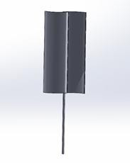
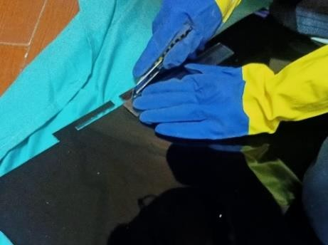
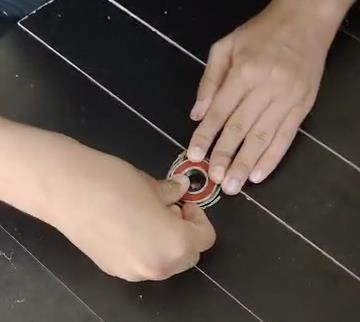
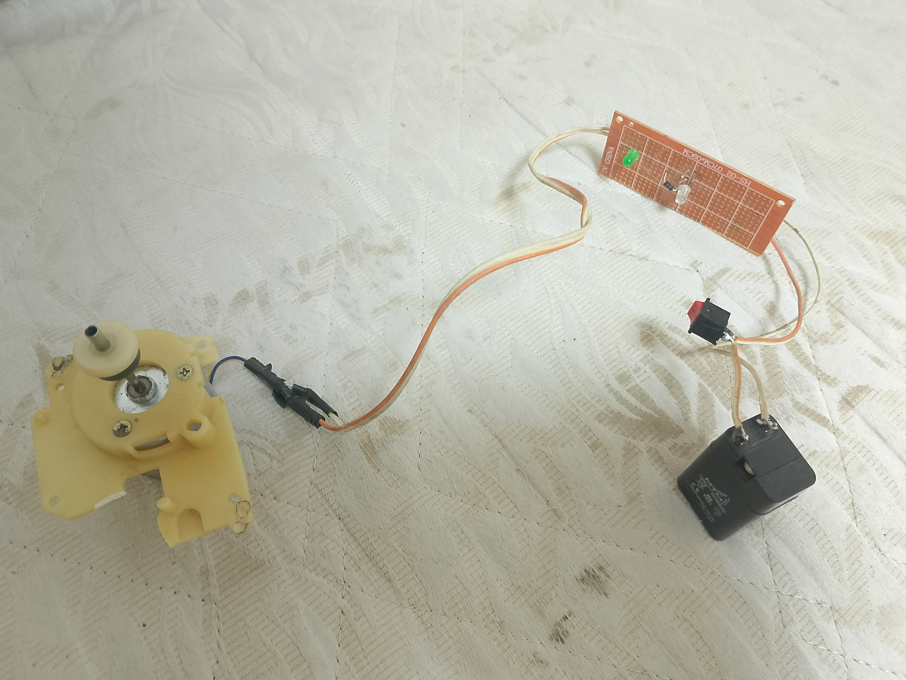
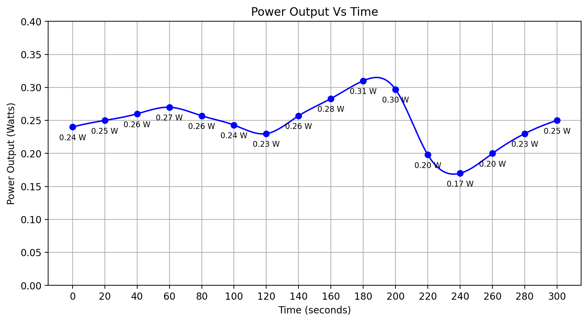

<h1 align="center">AirFlair</h1>

--------------------------
---------------------------------
### A double-helix vertical axis wind turbine that harvests wind from any direction at low speeds, rectifies the output and stores it in a rechargeable battery. Designed for power-short villages like Al Sayadeen in Nuweiba and built as a capstone project for STEM High School for Boys - 6th of October.

### 
[Main Features](#main-features) **-** [Prototype](#the-prototype) **-** [Testing](#testing) **-** [The Capstone](#the-capstone) **-** [Problem](#the-problem) **-** [Design Requirements](#design-requirements) **-** [Prior Solutions](#prior-solutions) **-** [Real Life](#real-life-application) **-** [Files](#whats-where)

--------------------------

## Main Features

- Double-helix vertical axis wind turbine. It takes wind from any direction, starts on its own at low speeds and has no yaw system to maintain.
- Drag-based: two concave aluminum blades make an S shape, and the wind pushes harder on the concave side so the rotor spins.
- An 80 cm shaft carries the rotor, held steady by bearing wheels. A 1:4 gearbox raises the speed to the generator, since direct drive was too slow.
- A DC generator feeds a bridge rectifier and a rectifier diode, then a rechargeable battery that powers a test LED.
- Measured volume of 0.043 m³ against the 0.5 m³ limit.

------------------------------------
------------------------------------

## The Prototype

- Two aluminum blades cut from sheets 23 cm wide and 60 cm long, curved into concave shapes and glued to the main shaft.
- A pipe main shaft, 80 cm long, moves the rotation to the generator and carries the moving parts.
- Bearing wheels keep the shaft in one direction and separate its movement from the base.
- The generator is wired to a bridge rectifier and a rectifier diode so current only flows one way into the rechargeable battery.
- It was planned as direct drive, but the rotor turned too slowly with too much torque, so a 1:4 gearbox was made.
- A few things went wrong on the way. An extra cut ruined one blade and it was recut, a soldering iron melted the inner layer of the shaft while making the blade openings, and the first curves were uneven so they were curved again on the same surface.

&nbsp;&nbsp;&nbsp;&nbsp;

<b>The 3D design of the blade and shaft, cutting the blades, and placing the bearing wheels.</b>

<b>The generator and its rectifier circuit.</b>

Selection process in the [Portfolio](Portfolio/), under Selection of Solution and Selection of Prototype.

------------------------------------

## Testing

- The turbine was placed in a windy spot, with an anemometer for the wind speed and two multimeters for voltage and current.
- At around 8 m/s the output went past the required 40 W·s inside the 5 minutes.
- Volume was measured by dipping the turbine in a graduated tub: 0.043 m³.
- The battery lit an LED, which confirmed it stores the energy.

<b>Power output against time over the 5 minute test.</b>

Test plan and results in the [Portfolio](Portfolio/).

------------------------------------

## The Capstone

The capstone is the biggest thing students do at STEM High School for Boys - 6th of October. A real problem, a working prototype for it, tests, and every step documented following the Engineering Design Process (EDP). Every term has its own design requirements and limitations that the design has to fit.

It is a team project. Grade 10, second term. The semester theme was harvesting and storing energy from unconventional resources, see the [challenge brief](Brief/Capstone%20Challenge%20G10%20Semester%202.pdf).

It runs through grades 10 and 11. On its own it is **60%** of the degree, and with its slice in every subject it is effectively around **80%** of the grades.

It has five parts:

- **Portfolio:** 60 to 80 pages in four chapters. Grand challenges, problem to be solved, prior solutions, selection of the solution, selection of the prototype, test plan, results, analysis, real-life recommendations and real-life location.
- **Poster:** Introduction, abstract, materials, methods, analysis, test plan, conclusion, real-life recommendations, citations and acknowledgements to everyone who helped.
- **Prototype:** The physical build, tested against the test plan.
- **Journals:** Every two weeks. Questions on personal reflection and the EDP process plus two connections between the project and the subjects taken. Other schools grade them anonymously on a red, yellow, green & blue scale and they are a key factor in the degree. Scores depend on the reviewers and vary significantly.
- **Logbook:** A weekly record of the work.

**This repository holds the project files only. The portfolio, the poster sections, the presentation, the test data and the logbook.**

------------------------------------

## The Problem

Egypt depends on fossil fuels for its power. In 2021, 94% of the energy supply was non-renewable, with gas at 54% and oil at 38%. That makes electricity expensive, drives pollution and climate change, and leaves far places like South Sinai badly served because the grid has to reach them from the center of the country. Cheap power is also what is missing for mining, industry and farming there.

The grand challenges behind the project are improving the use of alternative energies, addressing and reducing pollution in air, water and soil, reducing and adapting to the effects of climate change, and working to eradicate public health issues. The problem to be solved is reducing power shortage through alternative energy.

Full write-up in [Problem To Be Solved](Portfolio/Problem%20To%20Be%20Solved/Problem%20To%20Be%20Solved.docx). Sources in [Problem To Be Solved Sources](Portfolio/Problem%20To%20Be%20Solved/Problem%20To%20Be%20Solved%20Sources.txt).

------------------------------------

## Design Requirements

- Produce at least 40 W·s (40 J) in at most 5 minutes.
- Store the energy in a storage device so it can be used at any time. Ready-made power banks were not allowed.
- A prototype volume of no more than 0.5 m³.
- Use waste material where possible, and stay eco-friendly.
- User friendly, fast at producing energy, and quiet so it does not get in the way of students.
- Built with the fab lab tools only, with no piezoelectric generation and no hydrogen.

------------------------------------

## Prior Solutions

Four existing solutions were reviewed before the design was chosen.

- **Dogger Bank Wind Farm, UK.** A direct drive, gearless offshore farm with low maintenance cost and wear. Its turbines are huge, with a nacelle over 600 tons and 107 m blades, which makes moving and installing them hard.
- **Benban Solar Park, Egypt.** Cuts around 2 million tons of CO₂ every year. It uses 37 km² of desert land that could go to farming, and it produces nothing at night.
- **Aswan High Dam, Egypt.** The largest power plant in Egypt at 2,100 MW, with flood control and irrigation benefits. It displaced up to 100,000 Nubians and traps the Nile's nutrients behind it.
- **Bieudron Hydro Power Plant, Switzerland.** 1,269 MW from Pelton turbines in a high-head plant. A penstock rupture in 2000 and high production costs are its weaknesses.

Full review in [Grand Challenges and Prior Solutions](Portfolio/Grand%20Challenges%20and%20Prior%20Solutions/).

------------------------------------

## Real Life Application

Recommended for Al Sayadeen village in Nuweiba, South Sinai, where winds run at 3 to 6 m/s and change direction, the conditions a helix turbine works best in. In real life the blades would be aluminum, the tower and shaft steel and the wiring copper, with inverters.

Three improvements are recommended but were not built because of cost: a data system with an RPM sensor, an anemometer and a wattmeter, carbon fiber blades, and a centrifugal automatic brake that slows the turbine in dangerous wind speeds.

Details in the [Portfolio](Portfolio/), under Recommendations.

------------------------------------

## What's Where

- [Portfolio](Portfolio/) - the full portfolio, chapter 1, the problem write-up, prior solutions and research notes
- [Poster](Poster/) - the abstract, introduction, conclusion and acknowledgments
- [Presentation](Presentation/) - the presentation slides
- [Brief](Brief/) - the capstone challenge for this semester
- [Data](Data/) - the power output graph
- [Photos](Photos/) - the build photos and the 3D design
- [Logbook](Logbook/) - the weekly logbook and its figures

------------------------------------

## License

See [LICENSE](LICENSE).
